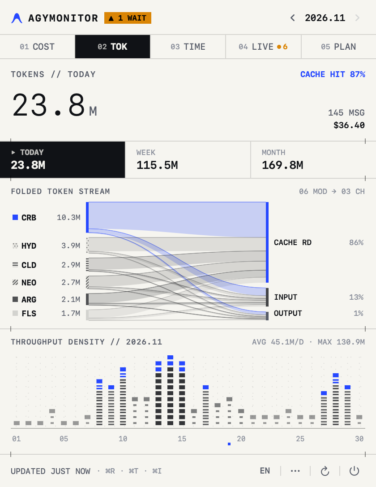
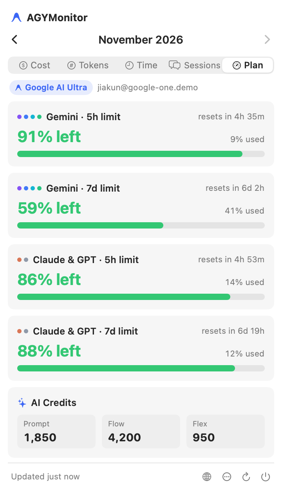
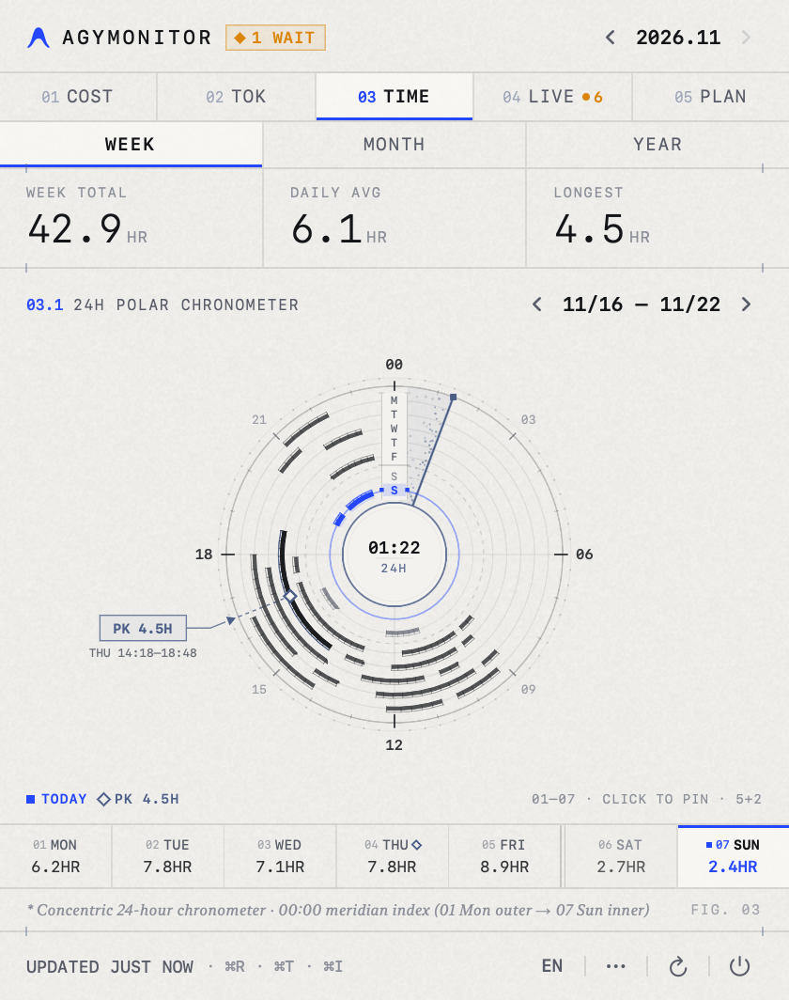
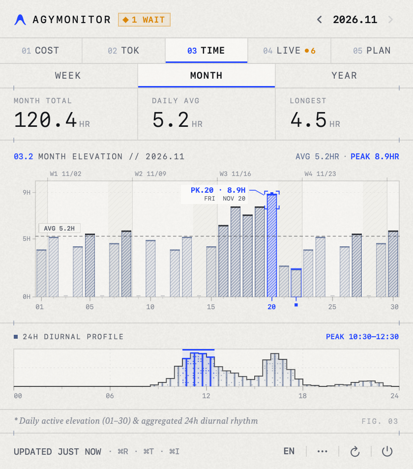
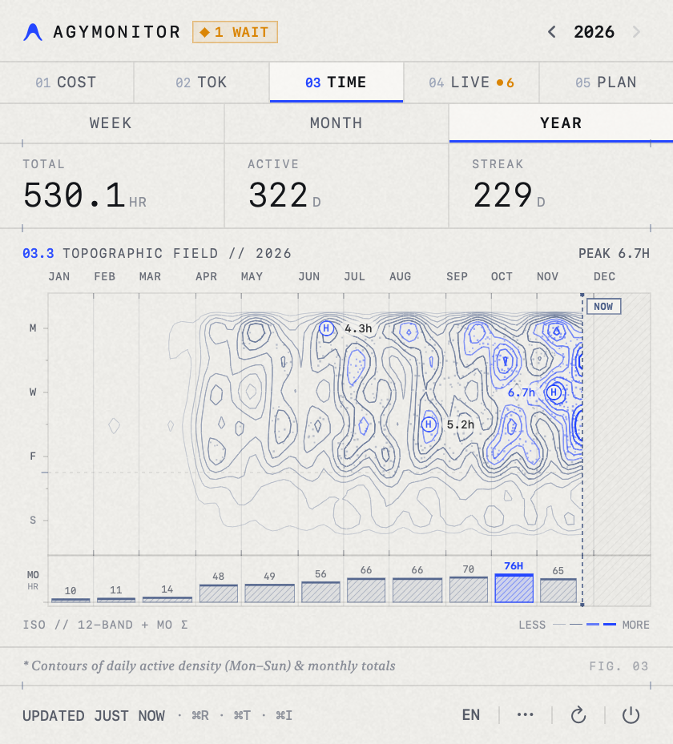
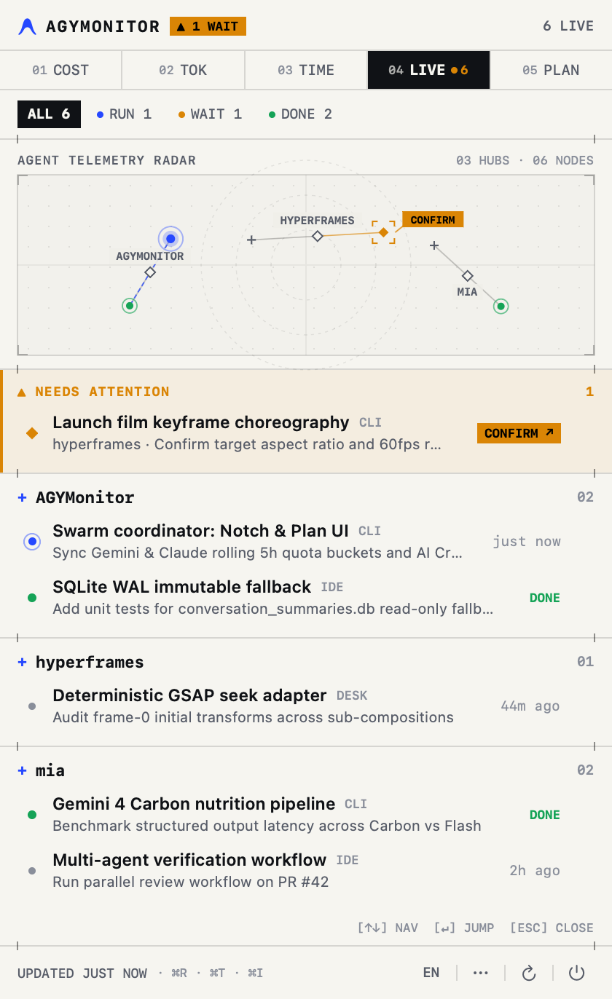

# AGY Monitor

[English](#english) | [中文](#中文)

<table>
  <tr>
    <td align="center"><br/><sub><b>Cost</b> — Stratigraphic Core breakdown &amp; Topographic Ridge daily elevation</sub></td>
    <td align="center"><br/><sub><b>Tokens</b> — Folded Token Stream (model → channel) &amp; 30-day Throughput Density matrix</sub></td>
    <td align="center"><br/><sub><b>Plan</b> — Dual 270° Orbital Phase dials with pace ray + Google One AI Credits</sub></td>
  </tr>
  <tr>
    <td align="center"><br/><sub><b>Time · Week</b> — 24h Polar Chronometer with 00:00 meridian index, 5+2 split &amp; click-to-pin</sub></td>
    <td align="center"><br/><sub><b>Time · Month</b> — 30-day elevation profile + aggregated 24h diurnal rhythm</sub></td>
    <td align="center"><br/><sub><b>Time · Year</b> — Honest Marching-Squares contours with Mon–Sun axis, NOW cutoff &amp; monthly totals</sub></td>
  </tr>
  <tr>
    <td align="center" colspan="3"><br/><sub><b>Sessions</b> — Agent Telemetry Radar (clickable nodes &amp; swarm links) + workspace groups</sub></td>
  </tr>
</table>

<sub>Screenshots are rendered from the app's real SwiftUI views (<code>docs/render_mockups.swift</code>) with synthetic demo data — no real usage.</sub>

### ✳ Notch mode

<table>
  <tr>
    <td width="300"></td>
    <td valign="middle">
      Prefer the MacBook notch to the menu bar? Switch the display into <b>notch mode</b> and your Antigravity telemetry lives in the display notch — hover to drop the full popover across all five tabs.
      <ul>
        <li><b>Idle pill</b> — Antigravity logo + your current value, hugging the notch</li>
        <li><b>Hover to expand</b> — the black notch grows seamlessly into the full popover</li>
        <li><b>Every display</b> — a synthetic notch appears on external monitors too</li>
        <li><b>Respects fullscreen</b> — hides for immersion; push the pointer against the top 8pt edge (the same gesture that summons the menu bar) and it slides back in cleanly</li>
      </ul>
      <sub><b>Enable:</b> click <b>⋯</b> in the popover footer → <b>Display location</b> → <b>Notch</b>.</sub>
    </td>
  </tr>
</table>

---

## English

macOS menu bar & notch app that tracks your **Google Antigravity** (`agy` CLI, Antigravity 2.0 Desktop, and Antigravity IDE) token usage, API-equivalent cost, active coding time, live sessions, and plan quota. Parses local transcripts and session metadata — zero tokens consumed, local session data stays on your Mac.

### Why this exists

Antigravity runs across multiple surfaces — the `agy` CLI in your terminal, Antigravity 2.0 Desktop, Antigravity IDE, and multi-agent Swarms spawning background worker conversations. Interactive `/usage` and `/credits` overlays only show current bucket percentages inside a single TUI session, with no cross-workspace token totals, historical trends, active-time heatmaps, or unified live-session switcher.

`AGYMonitor` aggregates every Antigravity surface on disk into one lightweight native macOS status item (or notch pill).

### What you get

- **Swiss Telemetry & 5 Instrument Visualizations (`⌘I` to toggle `Instrument` / `Classic`)** — scientific Instrument visualizations on every tab (`Borehole Strata` + `Topographic Ridge` for Cost, `Folded Token Stream` + `Density Matrix` for Tokens, `24h Polar Chronometer` + `Year Contour Field` for Time, clickable `Agent Telemetry Radar` for Sessions, and `Orbital Phase Dials` with burn-pace vectors for Plan), plus one-key Classic charts fallback
- **7 Switchable Studio Themes (`⌘T`)** — `Monolith` (Cobalt × Slate), `Google` (Primary 4-Color Spectrum), `Polar` (Indigo × Orange), `Riso` (Pink × Cobalt), `Atelier` (Amber × Teal), `Heritage` (Pine × Gold), and `Telemetry` (Volt × Violet), weaving coordinated chromatic voices across every tab in Light, Dark, and Notch modes
- **Cost & Tokens** — switch seamlessly between API-equivalent spend and token volume across Today / Week / Month, broken down by Antigravity model family (**Gemini Carbon**, **Gemini Argon**, **Gemini Neon**, **Gemini Hydrogen**, **Gemini Flash**, **Claude**, and **Other**)
- **Time** — *when* you actually worked with Antigravity, computed from 10-minute gap-merged step timestamps:
  - **Week** — **24h Polar Chronometer** (00:00 meridian weekday index gate, 5+2 weekday/weekend split, click-to-pin rings, & live `NOW` radar ray) or Classic `Mon–Sun × 0–24h` traces
  - **Month** — **Monthly Elevation & 24h Diurnal Profile** (30-day stratified elevation bars vs `AVG` + aggregated 48-bin diurnal rhythm with cross-deck hover) or Classic 7-column calendar timeline
  - **Year** — **Marching-Squares Topographic Contour Field** with `Mon–Sun` weekday axis, honest `NOW` cutoff, `[H]` peaks, & 12-month elevation strip (or Classic 53×7 activity heatmap)
- **Sessions** — **Agent Telemetry Radar** plotting workspace hubs, swarm worker links (`parentSessionId`), amber target-lock brackets on waiting sessions, and busy optical pulses — click any radar beacon or workspace row below (`↑↓` + `↵`) to jump straight to its terminal pane/tab (Otty, Apple Terminal, iTerm2, WezTerm, Ghostty, Kitty, Alacritty, Antigravity IDE)
- **Plan & AI Credits** — dual **270° Orbital Phase Dials** with burn-rate pace vectors & deficit warning wedges across Antigravity's rolling buckets (**Gemini Models** and **Claude & Partner**) alongside weekly horizons, plan tier, and **Google One AI Credits** (`Prompt`, `Flow`, `Flex`)
- **Notch Live Activity Wing & Customizable Status Bar** — Waiting sessions hold a clickable alert wing beside the hardware notch; Finished sessions announce for 5s and retract cleanly. Customize status bar readout (`Follow Tab`, `Today Cost`, `5h Quota`, `Live Sessions`, `Cost + 5h Quota`) via right-click or `⋯` menu
- **Month navigation & durable archive** — browse historical months; local daily archive (`~/Library/Application Support/AGYMonitor/`) preserves stats even if old transcripts are cleaned up
- **4 languages** — English, 简体中文, 繁體中文, 日本語
- **Zero-permission Global Hotkey (`⌥⇧A`), Auto-refresh (`⌘R`), & Built-in Update Checker** — Carbon hotkey toggle without Accessibility prompts, FSEvents file watching + 30-min timer + screen-wake observer, plus daily zero-API-quota GitHub Releases checks with in-app update banner & one-time macOS notification
- **Menu bar or Notch** — `LSUIElement=true` accessory app with no Dock icon

### Requirements

- macOS 13+ (Universal binary: Apple Silicon `arm64` & Intel `x86_64`)
- Python 3.9+ (bundled with macOS / Xcode Command Line Tools at `/usr/bin/python3`)
- Google Antigravity CLI (`agy`), Antigravity 2.0 Desktop, or Antigravity IDE (`~/.gemini/`)

### Install

#### Download DMG

Grab `AGYMonitor.dmg` from [Releases](../../releases) and drag `AGYMonitor.app` to `Applications`.

First launch: right-click → **Open** (bypasses Gatekeeper for ad-hoc / self-signed builds).

#### Build from source

```bash
git clone https://github.com/kuen54/AGYMonitor.git
cd AGYMonitor
bash setup_signing.sh   # optional, one-time — creates a stable local signing identity
bash build.sh
open build/AGYMonitor.app
```

> If `swiftc` reports `redefinition of module 'SwiftBridging'`, run `bash fix_swift.sh`.

> **`setup_signing.sh`** (optional, run once) creates a `"AGYMonitor Self-Signed"` certificate in your login keychain so rebuilds keep a constant Designated Requirement. Without it, `build.sh` automatically falls back to ad-hoc signing (`-`).

#### Development notes

- **Swift Core unit tests** — `swift test` runs the `AGYCoreTests` suite (Swift Testing `import Testing`, requiring Xcode 16+ / Swift 6) against the pure Foundation-only `Sources/Core_*.swift` layer. `Package.swift` is a test harness only; the app itself compiles directly via `swiftc` in `build.sh`.
- **Python scanner tests** — `/usr/bin/python3 -m unittest discover -s Tests -p "test_*.py"` verifies `Resources/analyze_usage.py` under macOS system Python 3.9+.
- **Mockup screenshots** — `docs/render_mockups.swift` compiles against the real SwiftUI views in `Sources/` (excluding `main.swift`) to render `docs/*.png` via `ImageRenderer`.

### How it works

#### 1. Local Usage & Active Time (`Resources/analyze_usage.py`)

`AGYMonitor` invokes the bundled Python 3.9-compatible scanner across all three Antigravity data roots:

```
~/.gemini/antigravity-cli/brain/<conv-id>/.system_generated/logs/transcript.jsonl
~/.gemini/antigravity/brain/<conv-id>/.system_generated/logs/transcript.jsonl
~/.gemini/antigravity-ide/brain/<conv-id>/.system_generated/logs/transcript.jsonl
    → analyze_usage.py --json
    → Incremental per-file cache (~/Library/Caches/AGYMonitor/)
    → SwiftUI Popover / Notch
```

- Counts `PLANNER_RESPONSE` steps deduplicated by `(conversation_id, step_index)`, including swarm coordinator and worker trajectories (`brain/*`) while skipping `.system_generated/logs/chunks/` to never double-count.
- Respects Antigravity's exact token semantics: `input_tokens` is **uncached new input only**, `cache_read_tokens` is cached prompt input, and `output_tokens` combines thinking + response tokens (`total = input + output + cache_read + cache_write`). Supplements `cache_write` from `conversations/<conv-id>.db` (`gen_metadata`) when present.

#### 2. Live Sessions & Click-to-Jump (`SessionMonitor` & `SessionJumper`)

- Combines `~/.gemini/antigravity-cli/presence/*.lock` open-FD process detection, `~/.gemini/antigravity-cli/conversation_summaries.db` (with immutable-read WAL fallback) / `cache/conversation_metadata.json`, and tail-read `transcript.jsonl` step states to track live `agy` and IDE sessions in real time.
- Resolves each process's controlling TTY and parent GUI app to jump directly to the exact pane/tab in Otty (`otty-cli`), Apple Terminal, iTerm2, or WezTerm, or bring Ghostty / Kitty / Alacritty / Antigravity IDE forward.

#### 3. Plan Quota & AI Credits (`QuotaService`)

- Queries Cloud Code PA quota endpoints when live credentials are available and falls back cleanly to cached `antigravityUnifiedStateSync.userStatus` & `modelCredits` in `~/Library/Application Support/{Antigravity,Antigravity IDE}/User/globalStorage/state.vscdb` plus `~/.gemini/antigravity-cli/log/cli-*.log` account metadata.

### Project structure

No `.xcodeproj` — compiled directly with `swiftc` into a universal macOS binary. `Package.swift` exists strictly for `swift test`.

```
Sources/
  main.swift                  ← single-instance guard + NSApp .accessory bootstrap
  AppDelegate.swift           ← menu bar status item, NSPopover, timers, FSEvents watcher
  UsageStore.swift            ← @Published usage/time/quota state + archive & scan orchestration
  UsageArchive.swift          ← durable monthly archive in ~/Library/Application Support/AGYMonitor/
  UsageScriptClient.swift     ← off-main Python scanner runner with timeout escalation
  ProcessRunner.swift         ← bounded subprocess helper
  QuotaService.swift          ← Antigravity quota buckets, AI Credits & state.vscdb reader
  SessionStore.swift          ← isolated @Published live-session state + jump feedback
  SessionMonitor.swift        ← presence/*.lock + conversation_summaries.db + FSEvents liveness
  SessionJumper.swift         ← click-to-jump across Otty, Terminal, iTerm2, WezTerm & IDEs
  AITitleReader.swift         ← bounded tail reader for session titles & latest prompts
  AGYLogo.swift               ← official Antigravity cubic-bezier vector mark (UI + icon generator)
  Theme.swift                 ← Antigravity cosmic indigo brand accent & status palette
  Formatters.swift            ← currency, token (k/m/b), and relative time formatters
  Localization.swift          ← 4-language i18n dictionary (en, zh-Hans, zh-Hant, ja)
  Models.swift                ← app-layer quota, DisplayTab, TimeRange & DisplayMode models
  NotchFullscreen.swift       ← runtime SkyLight fullscreen space & detector wrappers
  NotchController.swift       ← per-display NotchPanel geometry, hover dwell & fullscreen edge gate
  NotchView.swift             ← NotchShape + compact pill / Live Wing ↔ expanded popover
  GlobalHotKey.swift          ← zero-permission Carbon RegisterEventHotKey (⌥⇧A)
  Views*.swift                ← Swiss Telemetry drafting views + 5 Instrument charts (Views_Instrument*.swift)
  Core_*.swift                ← pure Foundation-only core (models, ModelClass, usage/date/time
                                 math, monotonic archive, session/transcript/quota parsers,
                                 instrument geometry & contour fields, & explicit state machines)
Tests/
  AGYCoreTests/               ← Swift Testing unit test suites covering Core_*.swift
  test_analyze_usage.py       ← Python unit tests for the local usage scanner
  test_model_parity.py        ← Swift <-> Python model/version parity & split-brain guard
scripts/
  check.sh                    ← one-shot local/CI verification (lint, tests, optional --build)
Resources/analyze_usage.py    ← bundled Python 3.9+ Antigravity usage & active-time scanner
docs/render_mockups.swift     ← SwiftUI ImageRenderer generator for docs/*.png screenshots
generate_icon.swift           ← ASCII-art macOS squircle icon generator
build.sh                      ← universal swiftc build + icon + codesign + DMG packager
setup_signing.sh              ← optional one-time self-signed certificate setup
fix_swift.sh                  ← Command Line Tools SwiftBridging modulemap workaround
.github/workflows/build.yml   ← CI: plist lint → py_compile & unittest → swift test → DMG build
AGENTS.md                     ← developer & coding-agent architecture contract
Info.plist                    ← LSUIElement=true; single source of app version (1.7.0)
```

### On pricing accuracy

Google Antigravity plans combine rolling model quotas and Google One AI Credits rather than raw per-token invoices. `AGYMonitor` computes **API-equivalent cost estimates** using [LiteLLM](https://github.com/BerriAI/litellm) public rates (cached 24h) combined with Google's official standard (non-promotional) API list-rate floor for Antigravity model families (`Gemini Carbon`, `Argon`, `Neon`, `Hydrogen`, `3.8 Flash`, `Claude Opus/Sonnet`, `GPT-OSS`) so you can compare workload intensity across projects and days.

### Durable historical archive

`AGYMonitor` keeps a compact monotonic daily archive in `~/Library/Application Support/AGYMonitor/archive/YYYY-MM.json` (**enabled by default**). Even if you prune old transcripts under `~/.gemini/`, historical daily cost, token, and active-time totals remain intact. Toggle or clear the archive anytime from the footer **⋯** menu.

### Acknowledgments

Architecture, Notch interaction model, and UI polish inspired by [CCCostMonitor](https://github.com/kuen54/CCCostMonitor).

---

## 中文

macOS 菜单栏与刘海（Notch）原生监控应用，一站式查看 **Google Antigravity**（`agy` CLI、Antigravity 2.0 桌面端、Antigravity IDE）的 Token 用量、API 等效花费、活跃编码时长、实时会话与套餐配额。直接解析本地会话记录与状态库 —— **零额外 Token 消耗**，本地会话数据完全留在你的 Mac 上。

### 为什么做这个

Antigravity 同时运行在多个入口：终端里的 `agy` CLI、Antigravity 2.0 桌面应用、Antigravity IDE，以及多智能体 Swarm 派生的后台 worker 会话。内置的 `/usage` 和 `/credits` 仅能在单个交互式终端内查看当前配额百分比，无法跨工作区汇总 Token 与等效开销、回顾每日/每月趋势、查看活跃时间热力图或一键跳转到正在等待输入的终端窗口。

`AGYMonitor` 将本机所有 Antigravity 数据源汇总到一个轻量的菜单栏图标（或屏幕刘海悬浮条）中。

### 功能亮点

- **Swiss Telemetry 与 5 大非常规仪器图表（`⌘I` 一键切换 `仪器风格` / `经典图表`）** — 5 个标签页默认提供仪器级可视化（Cost：**地质岩芯剖面 + 等高山脊**；Tokens：**折叠贝塞尔流向 + 吞吐脉冲矩阵**；Time：**24h 极坐标日晷 + 全年等高地形场**；Sessions：**可点击跳转的 Agent 态势雷达**；Plan：**270° 极坐标燃速罗盘与配速警告扇区**），也可随时切回经典柱图/热力图
- **7 套可切换视觉主题（`⌘T` 循环切换）** — 内置 `Monolith`（钴蓝 × 石墨）、`Google`（经典四色光谱）、`Polar`（靛蓝 × 工程橙）、`Riso`（荧光粉 × 联邦蓝）、`Atelier`（琥珀 × 石油青）、`Heritage`（赛车绿 × 鎏金）与 `Telemetry`（酸绿 × 紫外），全 5 个 Tab 深度语义联动并自适应浅色/深色/刘海模式
- **费用 & Tokens 双视图** — 支持切换今日/本周/本月汇总，按 Antigravity 模型家族拆分（**Gemini Carbon**、**Gemini Argon**、**Gemini Neon**、**Gemini Hydrogen**、**Gemini Flash**、**Claude** 与 **Other**）
- **活跃时长（Time）** — 基于 10 分钟间隔合并算法还原你**何时**在使用 Antigravity：
  - **周视图** — **24h 极坐标日晷**（`00:00` 顶轴环序刻度门、工作日/周末 `5+2` 断层、点击锁定单环与实时 `NOW` 扫频指针，或经典 `周一~周日 × 0–24h` 时间轴）
  - **月视图** — **30 天海拔剖面 + 24h 昼夜节律带**（全月每日时长海拔 vs 月均基线 + 48 档昼夜分布与双层联动悬停，或经典 7 列月历）
  - **年视图** — **Marching Squares 全年等高地形场**（`周一~周日` 纵轴、`NOW` 自然截断、`[H]` 高峰标注与 12 个月汇总海拔条，支持切回 53×7 GitHub 格子热力图）
- **实时会话（Sessions）** — 顶部 **Agent 态势雷达** 按工作区聚簇展示节点与 Swarm 子 Agent 连线，等待确认会亮起琥珀目标锁定角标；下方按工作区列出会话标题与最新指令（支持 `↑↓` + `↵` 键盘导航，点击雷达信标或列表行均可直接跳转到 Otty / Terminal / iTerm2 / WezTerm / Antigravity IDE）
- **套餐配额 & AI Credits（Plan）** — 双环 **270° 极坐标燃速罗盘** 与配速预警展示 Antigravity 滚动配额池（**Gemini Models**、**Claude & Partner**）的剩余百分比、7D 周配额、重置倒计时及 **Google One AI Credits**（`Prompt`、`Flow`、`Flex` 积分）
- **刘海灵动翼（Notch Live Wing）& 状态栏自定义** — 刘海模式下支持等待会话持久警示与完成后 5 秒自动收起；右键或 `⋯` 菜单可自定义状态栏指标（跟随当前标签 / 今日花费 / 5h 剩余配额 / 实时会话 / 花费 + 配额）
- **月份导航 & 本地持久归档** — 自由翻阅历史月份；每日汇总自动归档至 `~/Library/Application Support/AGYMonitor/`（默认开启），清理旧日志后历史统计依然完整保留
- **4 种语言** — English、简体中文、繁體中文、日本語
- **免授权全局快捷键（`⌥⇧A`）、智能自动刷新（`⌘R`）与版本更新提醒** — 内置 Carbon 全局热键（无需辅助功能权限）；FSEvents 监听本地目录变化 + 30 分钟定时器 + 唤醒刷新；每日免额度检查 GitHub Releases，支持应用内更新提示条与新版本一次性 macOS 系统通知
- **纯粹菜单栏 / 刘海体验** — 无 Dock 图标；可在底部 **⋯** → **显示位置** → **刘海** 开启全屏友好的刘海模式（外接显示器亦支持合成刘海）

### 系统要求

- macOS 13+（Apple Silicon `arm64` 与 Intel `x86_64` 通用二进制）
- Python 3.9+（macOS / Xcode Command Line Tools 自带 `/usr/bin/python3`）
- 已安装 Google Antigravity CLI（`agy`）、Desktop 或 IDE（数据位于 `~/.gemini/`）

### 安装方式

#### 下载 DMG

从 [Releases](../../releases) 下载 `AGYMonitor.dmg`，将 `AGYMonitor.app` 拖入 `Applications`。

首次打开请右键点击应用 → 选择**打开**（绕过未公证应用的 Gatekeeper 提示）。

#### 从源码构建

```bash
git clone https://github.com/kuen54/AGYMonitor.git
cd AGYMonitor
bash setup_signing.sh   # 可选，仅首次运行 — 生成本地稳定自签名证书
bash build.sh
open build/AGYMonitor.app
```

> 若 `swiftc` 提示 `redefinition of module 'SwiftBridging'`，请运行 `bash fix_swift.sh`。

### 工作原理

1. **本地 Token 与时长扫描（`Resources/analyze_usage.py`）**：扫描 `~/.gemini/{antigravity-cli,antigravity,antigravity-ide}/brain/*/.system_generated/logs/transcript.jsonl` 中的 `PLANNER_RESPONSE` 步骤（包含 Swarm 子智能体会话，自动跳过 `chunks/` 防止重复计数），按 `(conversation_id, step_index)` 去重，并通过增量文件指纹缓存（`~/Library/Caches/AGYMonitor/`）实现毫秒级热启动扫描。严格遵循 Antigravity 的计费字段语义：`input_tokens` 仅为未缓存的新增输入，总 Token = `input_tokens + output_tokens + cache_read_tokens + cache_write`。
2. **实时会话检测与终端跳转（`SessionMonitor` & `SessionJumper`）**：结合 `~/.gemini/antigravity-cli/presence/*.lock` 进程文件锁、`conversation_summaries.db`（支持只读 WAL immutable 回退）与 `transcript.jsonl` 尾部状态，实时追踪会话忙闲并在点击时精准聚焦对应终端窗格。
3. **套餐配额与积分（`QuotaService`）**：支持通过 Cloud Code PA 接口获取实时配额，并在离线或桌面端缓存场景下无缝回退读取 `state.vscdb`（`antigravityUnifiedStateSync.userStatus` / `modelCredits`）与 CLI 日志账户信息。

### 关于费用估算

Google Antigravity 采用滚动模型配额池与 Google One AI Credits 机制计费。`AGYMonitor` 结合 [LiteLLM](https://github.com/BerriAI/litellm) 公开价格表（本地缓存 24 小时）与 Antigravity 模型家族等效费率表计算 **API 等效花费**，便于直观衡量不同项目与日期的模型算力消耗。

### 致谢

架构设计、刘海交互体验与界面打磨参考自 [CCCostMonitor](https://github.com/kuen54/CCCostMonitor)。

---

## License

[Apache 2.0](LICENSE)
