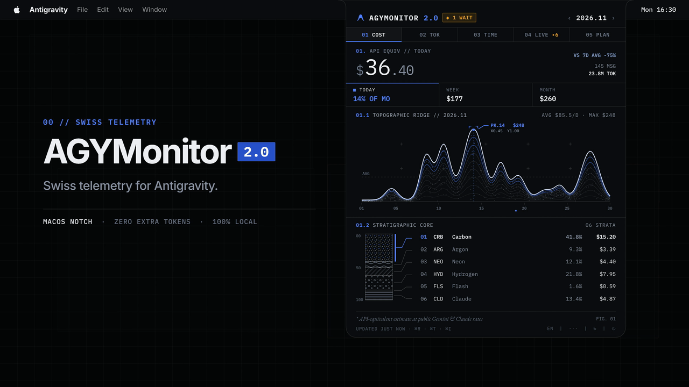
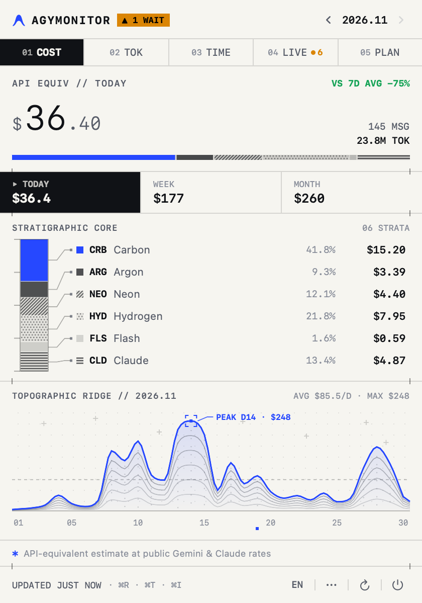
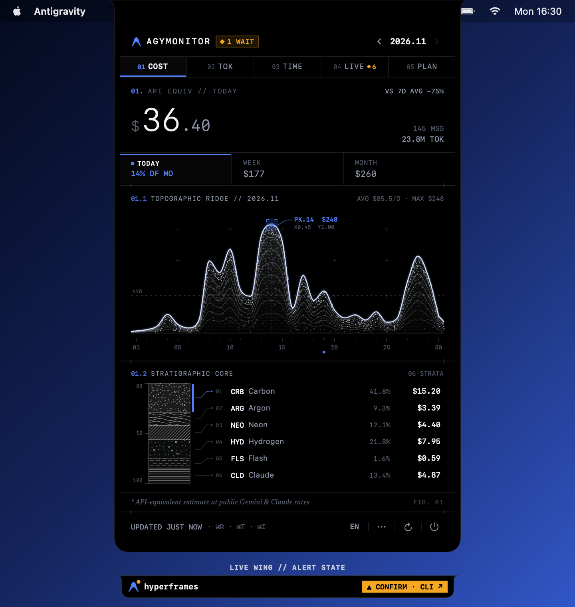

# AGY Monitor

<p align="center">
  <b>Swiss telemetry for Google Antigravity — native macOS Menu Bar &amp; Notch instrument</b>
</p>

<p align="center">
  <a href="https://github.com/kuen54/AGYMonitor/releases/tag/v2.0.3"></a>
  
  
  
  <a href="LICENSE"></a>
</p>

<p align="center">
  <a href="#english">English</a> · <a href="#中文">中文</a> · <a href="https://github.com/kuen54/AGYMonitor/releases/tag/v2.0.3">Download v2.0.3</a>
</p>

<p align="center">
  <a href="https://github.com/kuen54/AGYMonitor/releases/download/v2.0.0/AGYMonitor-2.0-launch.mp4">
    
  </a>
  <br/>
  <sub>▶ <a href="https://github.com/kuen54/AGYMonitor/releases/download/v2.0.0/AGYMonitor-2.0-launch.mp4"><b>Watch the AGYMonitor 2.0 Launch Film</b></a> (4K · 60fps · 0:38) — hosted on <a href="https://github.com/kuen54/AGYMonitor/releases/tag/v2.0.0">GitHub Releases</a></sub>
</p>

<table>
  <tr>
    <td align="center"><br/><sub><b>Cost</b> — Stratigraphic Core breakdown &amp; Topographic Ridge daily elevation</sub></td>
    <td align="center"><br/><sub><b>Tokens</b> — Folded Token Stream (model → channel) &amp; 30-day Throughput Density matrix</sub></td>
    <td align="center"><br/><sub><b>Plan</b> — Dual 270° Orbital Phase dials with pace ray + Google One AI Credits</sub></td>
  </tr>
  <tr>
    <td align="center"><br/><sub><b>Time · Week</b> — 24h Polar Chronometer with 00:00 meridian index, 5+2 split &amp; click-to-pin</sub></td>
    <td align="center"><br/><sub><b>Time · Month</b> — 30-day elevation profile + aggregated 24h diurnal rhythm</sub></td>
    <td align="center"><br/><sub><b>Time · Year</b> — Honest Marching-Squares contours with Mon–Sun axis, NOW cutoff &amp; monthly totals</sub></td>
  </tr>
  <tr>
    <td align="center" colspan="3"><br/><sub><b>Sessions</b> — Live Agent Telemetry Radar, Output TPS sparkline, Context Window meters &amp; Universal Black Box Replay</sub></td>
  </tr>
</table>

<sub>Screenshots are rendered from the app's real SwiftUI views (<code>docs/render_mockups.swift</code>) with synthetic demo data — no real usage.</sub>

### ✳ Notch mode

<table>
  <tr>
    <td width="300"></td>
    <td valign="middle">
      Prefer the MacBook notch to the menu bar? Switch the display into <b>notch mode</b> and your Antigravity telemetry lives in the display notch — hover or press <code>⌥⇧A</code> to drop the full popover across all five tabs.
      <ul>
        <li><b>Idle pill &amp; Live Activity Wing</b> — Antigravity mark + your current metric, plus a live <b>Output TPS sparkline</b> during active turns and an amber clickable alert wing whenever an agent waits for confirmation</li>
        <li><b>Hover or <code>⌥⇧A</code> to expand</b> — smooth reveal with instant keyboard focus on hotkey open (passive hover never steals focus from your editor)</li>
        <li><b>Every display</b> — a synthetic notch appears on external monitors too, with a compact closed backing store (~52 MB total footprint)</li>
        <li><b>Respects fullscreen</b> — hides for immersion; push the pointer against the top 8pt edge (the same gesture that summons the menu bar) and it slides back in cleanly</li>
      </ul>
      <sub><b>Enable:</b> click <b>⋯</b> in the popover footer → <b>Display location</b> → <b>Notch</b>.</sub>
    </td>
  </tr>
</table>

---

## English

macOS menu bar & notch app that tracks your **Google Antigravity** (`agy` CLI, Antigravity 2.0 Desktop, and Antigravity IDE) token usage, API-equivalent cost, active coding time, live sessions, and plan quota. Parses local transcripts and session metadata — **zero extra tokens consumed**, local session data stays on your Mac.

### Why this exists

Antigravity runs across multiple surfaces — the `agy` CLI in your terminal, Antigravity 2.0 Desktop, Antigravity IDE, and multi-agent Swarms / Workflows / Subagent trees spawning background worker conversations. Interactive `/usage` and `/credits` overlays only show current bucket percentages inside a single TUI session, with no cross-workspace token totals, historical trends, active-time heatmaps, real-time subagent TPS, or unified live-session switcher.

`AGYMonitor` aggregates every Antigravity surface on disk into one lightweight native macOS status item (or notch pill).

### What's new in v2.0.0

- **Universal Subagent Output TPS (True Single-Turn Accuracy)** — aggregates live output speed across main sessions and **every** CLI, Desktop, IDE, nested (`D0 → D1 → D2+`), Workflow, and Swarm subagent via symmetric multi-surface SQLite merging and stat-cached `.system_generated/subagents/` discovery, computing true per-turn `outputTokens / max(1.0, completedAt - createdAt)` without dropping long 90–276s heavy agent turns.
- **0% Busy CPU & ~52 MB Footprint** — replaced `/bin/ps` + `/usr/sbin/lsof` subprocesses with native Darwin `libproc` FD/CWD discovery (`~85ms → ~1.7ms`, zero forks), replaced the SwiftUI busy-logo `TimelineView` with GPU-composited Core Animation (`0` main-thread idle wakeups), shrank the closed `NotchPanel` backing store (`~185 MB → ~52 MB`, GPU dirty `89.6 MB → 1.6 MB`), and added idle/memory-pressure artwork cache trimming.
- **11 Pure Foundation `AGYCore` State Machines** — every lifecycle across Notch, MenuBarPanel, Usage, Quota, Monitor, Update, Black Box Replay, Haptics, Acoustics, Daily Blueprint Wallpaper, Specimen Exporter, and interactive UI inspection runs in pure deterministic Foundation reducers (`221` Swift tests + `22` Python tests, zero shadow booleans).
- **Production Hardening & UX Polish** — pure in-memory 44-byte WAV `NSSound(data:)` chimes (zero `AVAudioEngine` route-switch crashes), 60fps Black Box radar/waterfall caching + Reduce Motion support, strict scrollable `PanelHeightBudget` (pinned header/tabs even with 13+ live sessions), rock-solid Black Box `‹`/`›` panel height, sheet-native Specimen save dialog, and full 4-language key/format parity.

### Full feature highlights

- **5-Tab Precision Instrument Mode + Classic Fallback (`⌘I`) & 7 Curated Palettes (`⌘T`)** — scientific Swiss Telemetry instruments on every tab (`Cost`: Borehole Strata & Topographic Ridge; `Tokens`: Folded Token Flow Sankey & 30-day Density Matrix; `Time`: 24h Polar Chronometer / Month Elevation + 24H Diurnal / Marching-Squares Year Contour; `Sessions`: Live Agent Telemetry Radar + Universal Black Box Replay; `Plan`: Dual 270° Orbital Phase Gauges with burn-pace vectors), paired with one-key Classic charts and 7 coordinated themes (`Monolith`, `Google`, `Polar`, `Riso`, `Atelier`, `Heritage`, `Telemetry`) across Light, Dark, and Notch modes
- **Cost & Tokens** — switch seamlessly between API-equivalent spend and token volume across Today / Week / Month, broken down by Antigravity model family (**Gemini Carbon**, **Gemini Argon**, **Gemini Neon**, **Gemini Hydrogen**, **Gemini Flash**, **Claude**, and **Other**)
- **Time** — *when* you actually worked with Antigravity, computed from 10-minute gap-merged step timestamps:
  - **Week** — **24h Polar Chronometer** (00:00 meridian weekday index gate, 5+2 weekday/weekend split, click-to-pin rings, & live `NOW` radar ray) or Classic `Mon–Sun × 0–24h` traces
  - **Month** — **Month Elevation & 24H Diurnal Profile** (30-day stratified elevation bars vs `AVG` + aggregated 48-bin diurnal rhythm with cross-deck hover) or Classic 7-column calendar timeline
  - **Year** — **Marching-Squares Topographic Contour Field** with `Mon–Sun` weekday axis, honest `NOW` cutoff, `[H]` peaks, & 12-month elevation strip (or Classic 53×7 activity heatmap)
- **Live Agent Radar & Universal Black Box Replay** — **Agent Telemetry Radar** plots workspace hubs, swarm worker links (`parentSessionId`), live aggregated **Output TPS sparkline + readout**, amber target-lock brackets on waiting sessions, and per-session **Context Window remaining %** micro-meters with `/compact` warning badges. Click any radar beacon or workspace row (`↑↓` + `↵`) to jump straight to its terminal pane/tab (Otty, Apple Terminal, iTerm2, WezTerm, Ghostty, Kitty, Alacritty, Antigravity IDE). Toggle **`BLACK BOX`** to replay recent **Swarm**, **Dynamic Workflow**, **Subagent Tree**, **Battle**, or **Solo** trajectories at 60fps with adaptive 20s pacing, smart dead-air skip (`3.2×`), key-event stepping, animated message beams, and multi-track retry/human-wait waste forensics
- **Plan & AI Credits** — dual **270° Orbital Phase Gauges** with burn-rate pace vectors & deficit warning wedges across Antigravity's rolling buckets (**Gemini Models** and **Claude & Partner**) alongside weekly horizons, plan tier, and **Google One AI Credits** (`Prompt`, `Flow`, `Flex`)
- **Archival Specimen Card (`⌘E`), 5-Tab Force Touch Haptics, Harmonic Chimes & Daily Blueprint Wallpaper** — Press `⌘E` to preview & export museum-grade `4:5` & `16:9` `@2x` PNG archival specimen posters (Polar Chronometer, Year Topography, cache grade & operator archetype) in your active palette; enjoy Instrument-bound 5-Tab Force Touch haptic feedback, optional pure-code harmonic acoustic cockpit chimes, and auto-updating `00:00` Daily Blueprint Contour Desktop Wallpapers under `⋯ → Craft & Wallpaper`
- **Month navigation, durable archive, 4 languages & built-in updates** — browse historical months with a monotonic local daily archive (`~/Library/Application Support/AGYMonitor/`), switch between English / 简体中文 / 繁體中文 / 日本語, toggle globally via zero-permission Carbon hotkey (`⌥⇧A`), and receive silent daily zero-API-quota GitHub Releases checks (`LSUIElement=true`, no Dock icon)

### Keyboard shortcuts

| Shortcut | Scope | Action |
|---|---|---|
| `⌥⇧A` | Global | Toggle Menu Bar panel or Notch (zero Accessibility prompts) |
| `⌘1` – `⌘5` | Panel | Jump directly to Cost, Tokens, Time, Sessions, or Plan |
| `⌘[` / `⌘]` | Panel | Previous / Next month (or year in Time → Year) |
| `⌘R` | Panel | Force-refresh usage, active time, and plan quota |
| `⌘T` | Panel | Cycle through the 7 curated Studio Palettes |
| `⌘I` | Panel | Toggle Instrument / Classic visualization mode |
| `⌘E` | Panel | Open Archival Specimen Card preview & exporter |
| `Esc` | Panel / Specimen | Close active panel or Specimen Card window |
| `↑` / `↓` + `↵` | Sessions · Live | Select live session and jump to its terminal / IDE |
| `Space` / `←` / `→` | Sessions · Black Box | Play / Pause replay and step to previous / next key event |
| `⌘C` / `⌘S` / `⌘W` | Specimen Card | Copy `@2x` PNG to clipboard / Save PNG to disk / Close window |

### Requirements

- macOS 13+ (Universal binary: Apple Silicon `arm64` & Intel `x86_64`)
- Python 3.9+ (bundled with macOS / Xcode Command Line Tools at `/usr/bin/python3`)
- Google Antigravity CLI (`agy`), Antigravity 2.0 Desktop, or Antigravity IDE (`~/.gemini/`)

### Install

#### Download DMG

Grab `AGYMonitor.dmg` from [Releases](../../releases) and drag `AGYMonitor.app` to `Applications`.

**First launch on macOS 15 Sequoia+** (unsigned / ad-hoc builds — Sequoia removed *right-click → Open*):
1. Open `AGYMonitor.app` once and click **Done** on the Gatekeeper alert.
2. Open **System Settings → Privacy & Security**, scroll down, and click **Open Anyway**.
3. Alternatively, clear the quarantine attribute once in Terminal:
   ```bash
   xattr -cr /Applications/AGYMonitor.app
   ```

#### Build from source

```bash
git clone https://github.com/kuen54/AGYMonitor.git
cd AGYMonitor
bash setup_signing.sh   # optional, one-time — creates a stable local signing identity
bash build.sh
open build/AGYMonitor.app
```

> If `swiftc` reports `redefinition of module 'SwiftBridging'`, run `bash fix_swift.sh`.

> **`setup_signing.sh`** (optional, run once) creates a `"AGYMonitor Self-Signed"` certificate in your login keychain so rebuilds keep a constant Designated Requirement. Without it, `build.sh` automatically falls back to ad-hoc signing (`-`).

#### Development notes

- **Swift Core unit tests** — `swift test` runs the `AGYCoreTests` suite (Swift Testing `import Testing`, requiring Xcode 16+ / Swift 6) against the pure Foundation-only `Sources/Core_*.swift` layer (`221` tests across `22` suites). `Package.swift` is a test harness only; the app itself compiles directly via `swiftc` in `build.sh`.
- **Python scanner tests** — `/usr/bin/python3 -m unittest discover -s Tests -p "test_*.py"` verifies `Resources/analyze_usage.py` and Swift↔Python parity under macOS system Python 3.9+ (`22` tests).
- **One-shot verification** — `bash scripts/check.sh --build` runs `Info.plist` lint, `py_compile`, Python tests, `swift test`, and universal `.app` + strict `codesign` verification.
- **Mockup screenshots** — `docs/render_mockups.swift` compiles against the real SwiftUI views in `Sources/` (excluding `main.swift`) to render `docs/*.png` via `ImageRenderer`.

### How it works

#### 1. Local Usage & Active Time (`Resources/analyze_usage.py`)

`AGYMonitor` invokes the bundled Python 3.9-compatible scanner across all three Antigravity data roots:

```
~/.gemini/antigravity-cli/brain/<conv-id>/.system_generated/logs/transcript.jsonl
~/.gemini/antigravity/brain/<conv-id>/.system_generated/logs/transcript.jsonl
~/.gemini/antigravity-ide/brain/<conv-id>/.system_generated/logs/transcript.jsonl
    → analyze_usage.py --json
    → Incremental per-file cache (~/Library/Caches/AGYMonitor/)
    → SwiftUI Popover / Notch
```

- Counts `PLANNER_RESPONSE` steps deduplicated by `(conversation_id, step_index)`, including swarm coordinator and worker trajectories (`brain/*`) while skipping `.system_generated/logs/chunks/` to never double-count.
- Respects Antigravity's exact token semantics: `input_tokens` is **uncached new input only**, `cache_read_tokens` is cached prompt input, and `output_tokens` combines thinking + response tokens (`total = input + output + cache_read + cache_write`). Supplements `cache_write` from `conversations/<conv-id>.db` (`gen_metadata`) when present.

#### 2. Live Sessions & Click-to-Jump (`SessionMonitor` & `SessionJumper`)

- Combines native Darwin `libproc` FD/CWD discovery of `~/.gemini/antigravity-cli/presence/*.lock` (zero `lsof` subprocess spawns), symmetric multi-surface `conversation_summaries.db` (CLI / Desktop / IDE with immutable-read WAL fallback) / `cache/conversation_metadata.json`, `.system_generated/subagents/*.json` + `swarm/members.json`, and tail-read `transcript.jsonl` step states to track live `agy`, Desktop, IDE, and subagent sessions in real time.
- Resolves each process's controlling TTY and parent GUI app to jump directly to the exact pane/tab in Otty (`otty-cli`), Apple Terminal, iTerm2, or WezTerm, or bring Ghostty / Kitty / Alacritty / Antigravity IDE forward.

#### 3. Plan Quota & AI Credits (`QuotaService`)

- Queries Cloud Code PA quota endpoints when live credentials are available and falls back cleanly to cached `antigravityUnifiedStateSync.userStatus` & `modelCredits` in `~/Library/Application Support/{Antigravity,Antigravity IDE}/User/globalStorage/state.vscdb` plus `~/.gemini/antigravity-cli/log/cli-*.log` account metadata.

### Project structure

No `.xcodeproj` — compiled directly with `swiftc` into a universal macOS binary. `Package.swift` exists strictly for `swift test`.

```
Sources/
  main.swift                  ← single-instance guard + NSApp .accessory bootstrap
  AppDelegate.swift           ← menu bar status item, MenuBarPanel, timers, FSEvents watcher
  UsageStore.swift            ← @Published usage/time/quota state + archive & scan orchestration
  UsageArchive.swift          ← durable monthly archive in ~/Library/Application Support/AGYMonitor/
  UsageScriptClient.swift     ← off-main Python scanner runner with timeout escalation
  ProcessRunner.swift         ← bounded subprocess helper
  QuotaService.swift          ← Antigravity quota buckets, AI Credits & state.vscdb reader
  SessionStore.swift          ← isolated @Published live-session, TPS & Black Box replay store
  SessionMonitor.swift        ← native libproc presence/*.lock + multi-surface DB + subagent liveness
  SessionReplayService.swift  ← on-demand Black Box mission indexer & multi-track timeline parser
  SessionJumper.swift         ← click-to-jump across Otty, Terminal, iTerm2, WezTerm & IDEs
  AITitleReader.swift         ← bounded tail reader for session titles, prompts & output samples
  CraftEngine.swift           ← 5-Tab Force Touch haptics & pure-code harmonic acoustic chimes
  SpecimenExporter.swift      ← Archival Specimen Card preview controller & @2x PNG exporter (⌘E)
  WallpaperGenerator.swift    ← Daily Blueprint Contour desktop wallpaper renderer & scheduler
  UpdateService.swift         ← zero-API-quota GitHub Releases checker & one-time notification
  AGYLogo.swift               ← official Antigravity cubic-bezier vector mark (UI + Core Animation + icon)
  Theme.swift                 ← 7 curated Studio Palettes across Light, Dark, and Notch modes
  Formatters.swift            ← currency, token (k/m/b), and relative time formatters
  Localization.swift          ← 4-language i18n dictionary (en, zh-Hans, zh-Hant, ja)
  Models.swift                ← app-layer quota, DisplayTab, TimeRange & DisplayMode models
  NotchFullscreen.swift       ← runtime SkyLight fullscreen space & detector wrappers
  NotchController.swift       ← per-display NotchPanel geometry, hover dwell & fullscreen edge gate
  NotchView.swift             ← NotchShape + compact pill / Live Wing / TPS ↔ expanded panel
  GlobalHotKey.swift          ← zero-permission Carbon RegisterEventHotKey (⌥⇧A)
  Views*.swift                ← Swiss Telemetry drafting views, 5 Instrument charts (Views_Instrument*.swift),
                                 Black Box Replay (Views_SessionReplay.swift), & Specimen Card (Views_Specimen.swift)
  Core_*.swift                ← pure Foundation-only core (models, ModelClass, usage/date/time
                                 math, monotonic archive, session/transcript/quota/replay parsers,
                                 live TPS/context telemetry, instrument geometry & contour fields,
                                 & 11 explicit state machines)
Tests/
  AGYCoreTests/               ← Swift Testing unit test suites covering Core_*.swift (221 tests)
  test_analyze_usage.py       ← Python unit tests for the local usage scanner
  test_model_parity.py        ← Swift <-> Python model/version/i18n parity & split-brain guard
scripts/
  check.sh                    ← one-shot local/CI verification (lint, tests, optional --build)
Resources/analyze_usage.py    ← bundled Python 3.9+ Antigravity usage & active-time scanner
docs/render_mockups.swift     ← SwiftUI ImageRenderer generator for docs/*.png screenshots
docs/STATE_MACHINES.md        ← architecture contract & invariants for all 11 state machines
generate_icon.swift           ← macOS squircle icon generator
build.sh                      ← universal swiftc build + icon + codesign + DMG packager
setup_signing.sh              ← optional one-time self-signed certificate setup
fix_swift.sh                  ← Command Line Tools SwiftBridging modulemap workaround
.github/workflows/build.yml   ← CI: plist lint → py_compile & unittest → swift test → DMG build
AGENTS.md                     ← developer & coding-agent architecture contract
Info.plist                    ← LSUIElement=true; single source of app version (2.0.3)
```

### On pricing accuracy

Google Antigravity plans combine rolling model quotas and Google One AI Credits rather than raw per-token invoices. `AGYMonitor` computes **API-equivalent cost estimates** using [LiteLLM](https://github.com/BerriAI/litellm) public rates (cached 24h) combined with Google's official standard (non-promotional) API list-rate floor for Antigravity model families (`Gemini Carbon`, `Argon`, `Neon`, `Hydrogen`, `3.8 Flash`, `Claude Opus/Sonnet`, `GPT-OSS`) so you can compare workload intensity across projects and days.

### Durable historical archive

`AGYMonitor` keeps a compact monotonic daily archive in `~/Library/Application Support/AGYMonitor/archive/YYYY-MM.json` (**enabled by default**). Even if you prune old transcripts under `~/.gemini/`, historical daily cost, token, and active-time totals remain intact. Toggle or clear the archive anytime from the footer **⋯** menu.

### Acknowledgments

Architecture, Notch interaction model, and UI polish inspired by [CCCostMonitor](https://github.com/kuen54/CCCostMonitor).

---

## 中文

macOS 菜单栏与刘海（Notch）原生监控应用，一站式查看 **Google Antigravity**（`agy` CLI、Antigravity 2.0 桌面端、Antigravity IDE）的 Token 用量、API 等效花费、活跃编码时长、实时会话与套餐配额。直接解析本地会话记录与状态库 —— **零额外 Token 消耗**，本地会话数据完全留在你的 Mac 上。

### 为什么做这个

Antigravity 同时运行在多个入口：终端里的 `agy` CLI、Antigravity 2.0 桌面应用、Antigravity IDE，以及多智能体 Swarm / Dynamic Workflow / Subagent 树派生的后台会话。内置的 `/usage` 和 `/credits` 仅能在单个交互式终端内查看当前配额百分比，无法跨工作区汇总 Token 与等效开销、回顾每日/每月趋势、实时聚合全部子 Agent 输出速度或一键跳转到正在等待输入的终端窗口。

`AGYMonitor` 将本机所有 Antigravity 数据源汇总到一个轻量的菜单栏图标（或屏幕刘海悬浮条）中。

### v2.0.0 核心升级

- **全域子 Agent Output TPS（真实单轮精确计量）**：通过多端对称 SQLite 合并与 `.system_generated/subagents/` 缓存遍历，完整聚合主会话及全部 CLI / Desktop / IDE / 多级嵌套（`D0 → D1 → D2+`）/ Workflow / Swarm 子 Agent 的实时输出速度；按真实单轮耗时 `completedAt - createdAt` 计速，彻底根治 90–276 秒重度轮次归零或被压低的问题。
- **0% 忙碌 CPU 与 ~52 MB 轻量占用**：原生 Darwin `libproc` 进程文件句柄探测取代 `/bin/ps` + `lsof` 子进程（耗时 `~85ms → ~1.7ms`，0 fork）；GPU Core Animation 合成忙碌 Logo 取代主线程 `TimelineView`（`0` 空闲唤醒）；收起态紧致 `NotchPanel` 窗口尺寸（总内存 `~185 MB → ~52 MB`，GPU 显存 `89.6 MB → 1.6 MB`）与空闲/内存压力画布缓存裁剪。
- **11 套纯 Foundation `AGYCore` 显式状态机**：Notch、菜单栏面板、用量、配额、监控、更新、黑匣子回放、触觉节拍、谐波音频、每日地形壁纸、标本卡导出与图表交互全面收敛至确定性纯函数 Reducer（**221** 项 Swift 单测 + **22** 项 Python 单测，零影子布尔状态）。
- **2.0 生产级体验打磨**：纯内存 44 字节 WAV `NSSound(data:)` 替代 `AVAudioEngine`（消除蓝牙/音频设备切换崩溃风险）；60fps 黑匣子雷达/瀑布图布局缓存与「减少动态效果」适配；严格 `PanelHeightBudget` 防止 13+ 活跃会话裁切顶部栏；彻底根治 Black Box `‹`/`›` 高度塌陷、Specimen 导出 Sheet 层级与 4 语言文案一致率校验。

### 完整功能亮点

- **5 大精度仪器模式 + 经典视图回退（`⌘I`）与 7 套策展配色（`⌘T`）** — 5 个标签页默认提供 Swiss Telemetry 仪器可视化（Cost：**地质岩芯剖面 + 等高山脊**；Tokens：**折叠 Token 流向桑基图 + 30 天吞吐脉冲矩阵**；Time：**24h 极坐标日晷 / 30 天海拔剖面 + 24h 昼夜节律 / 全年 Marching-Squares 等高地形场**；Sessions：**实时 Agent 态势雷达 + 全形态黑匣子回放**；Plan：**双环 270° 极坐标燃速罗盘**），可一键切回经典图表，并在浅色/深色/刘海模式下无缝联动 7 套主题（`Monolith`、`Google`、`Polar`、`Riso`、`Atelier`、`Heritage`、`Telemetry`）
- **费用 & Tokens 双视图** — 支持切换今日/本周/本月汇总，按 Antigravity 模型家族拆分（**Gemini Carbon**、**Gemini Argon**、**Gemini Neon**、**Gemini Hydrogen**、**Gemini Flash**、**Claude** 与 **Other**）
- **活跃时长（Time）** — 基于 10 分钟间隔合并算法还原你**何时**在使用 Antigravity：
  - **周视图** — **24h 极坐标日晷**（`00:00` 顶轴环序刻度门、工作日/周末 `5+2` 断层、点击锁定单环与实时 `NOW` 扫频指针，或经典 `周一~周日 × 0–24h` 时间轴）
  - **月视图** — **30 天海拔剖面 + 24h 昼夜节律带**（全月每日时长海拔 vs 月均基线 + 48 档昼夜分布与双层联动悬停，或经典 7 列月历）
  - **年视图** — **Marching-Squares 全年等高地形场**（`周一~周日` 纵轴、`NOW` 自然截断、`[H]` 高峰标注与 12 个月汇总海拔条，支持切回 53×7 GitHub 格子热力图）
- **实时 Agent 态势雷达与全形态黑匣子回放** — 顶部 **Agent 态势雷达** 按工作区聚簇展示节点与 Swarm 子 Agent 连线，工作时实时显示聚合 **Output TPS 折线与速率**，等待确认亮起琥珀目标锁定角标；每条活跃会话内置 **Context Window 剩余百分比** 微型刻尺（低于 10% 亮出 `/compact` 提示），支持 `↑↓` + `↵` 或点击信标直达 Otty / Terminal / iTerm2 / WezTerm / Antigravity IDE。切至 **`黑匣子`** 模式可 60fps 回放近期 **Swarm / Dynamic Workflow / Subagent 树 / Battle / Solo** 全部 5 种组织形态轨迹，内置自适应 20 秒观影时长、智能 `3.2×` 滑过空白等待、关键事件跳帧与重试损耗/等待时长复盘
- **套餐配额 & AI Credits（Plan）** — 双环 **270° 极坐标燃速罗盘** 与配速预警展示 Antigravity 滚动配额池（**Gemini Models**、**Claude & Partner**）的剩余百分比、7D 周配额、重置倒计时及 **Google One AI Credits**（`Prompt`、`Flow`、`Flex` 积分）
- **刘海灵动翼与状态栏自定义** — 刘海模式下支持等待会话持久警示、完成后 5 秒自动收起，并在 Agent 工作时于刘海右翼与菜单栏实时展示 **Output TPS 折线 + `t/s` 速率**；右键或 `⋯ → 外观与显示` 可自定义状态栏指标
- **档案馆标本卡（`⌘E`）、5-Tab 仪器触控板震动、纯代码谐波提示音与每日地形壁纸** — 按 `⌘E` 一键预览并复制/保存当前主题的 `4:5` 与 `16:9` `@2x` 瑞士档案标本海报；与 `仪器风格` 绑定的 5-Tab 专属 Force Touch 触觉反馈，以及 `⋯ → 工艺与壁纸` 中独立可开关的纯代码谐波提示音与每日 `00:00` 浮雕等高线桌面壁纸
- **月份导航、持久归档、4 种语言与自动更新** — 自由翻阅历史月份并自动归档至 `~/Library/Application Support/AGYMonitor/`；支持 English / 简体中文 / 繁體中文 / 日本語；免辅助功能权限全局快捷键（`⌥⇧A`）与每日免额度 GitHub Releases 版本检查（`LSUIElement=true`，无 Dock 图标）

### 快捷键

| 快捷键 | 作用域 | 说明 |
|---|---|---|
| `⌥⇧A` | 全局 | 呼出 / 收起菜单栏面板或刘海（无需辅助功能权限） |
| `⌘1` – `⌘5` | 主面板 | 快速切换 费用 / Tokens / 时长 / 会话 / 套餐 标签页 |
| `⌘[` / `⌘]` | 主面板 | 切换上一月 / 下一月（年视图下切换上一年 / 下一年） |
| `⌘R` | 主面板 | 强制刷新用量、活跃时长与套餐配额 |
| `⌘T` | 主面板 | 循环切换 7 套策展视觉主题 |
| `⌘I` | 主面板 | 一键切换 仪器风格 / 经典图表 |
| `⌘E` | 主面板 | 打开档案馆标本卡预览与导出器 |
| `Esc` | 主面板 / 标本卡 | 关闭当前面板或标本卡窗口 |
| `↑` / `↓` + `↵` | 会话 · 实时 | 选中活跃会话并直达对应终端 / IDE |
| `Space` / `←` / `→` | 会话 · 黑匣子 | 播放 / 暂停回放与跳转上一 / 下一关键事件 |
| `⌘C` / `⌘S` / `⌘W` | 标本卡 | 复制 `@2x` PNG 到剪贴板 / 保存 PNG 到磁盘 / 关闭窗口 |

### 系统要求

- macOS 13+（Apple Silicon `arm64` 与 Intel `x86_64` 通用二进制）
- Python 3.9+（macOS / Xcode Command Line Tools 自带 `/usr/bin/python3`）
- 已安装 Google Antigravity CLI（`agy`）、Desktop 或 IDE（数据位于 `~/.gemini/`）

### 安装方式

#### 下载 DMG

从 [Releases](../../releases) 下载 `AGYMonitor.dmg`，将 `AGYMonitor.app` 拖入 `Applications`。

**macOS 15 Sequoia 及以上版本首次打开**（未公证/自签名版本，Sequoia 已移除右键「打开」）：
1. 双击打开 `AGYMonitor.app`，在 Gatekeeper 弹窗点击**完成**。
2. 前往 **系统设置 → 隐私与安全性**，向下滚动点击 **仍要打开**。
3. 或在终端执行一次以下命令移除隔离属性：
   ```bash
   xattr -cr /Applications/AGYMonitor.app
   ```

#### 从源码构建

```bash
git clone https://github.com/kuen54/AGYMonitor.git
cd AGYMonitor
bash setup_signing.sh   # 可选，仅首次运行 — 生成本地稳定自签名证书
bash build.sh
open build/AGYMonitor.app
```

> 若 `swiftc` 提示 `redefinition of module 'SwiftBridging'`，请运行 `bash fix_swift.sh`。

### 工作原理

1. **本地 Token 与时长扫描（`Resources/analyze_usage.py`）**：扫描 `~/.gemini/{antigravity-cli,antigravity,antigravity-ide}/brain/*/.system_generated/logs/transcript.jsonl` 中的 `PLANNER_RESPONSE` 步骤（包含 Swarm 子智能体会话，自动跳过 `chunks/` 防止重复计数），按 `(conversation_id, step_index)` 去重，并通过增量文件指纹缓存（`~/Library/Caches/AGYMonitor/`）实现毫秒级热启动扫描。严格遵循 Antigravity 的计费字段语义：`input_tokens` 仅为未缓存的新增输入，总 Token = `input_tokens + output_tokens + cache_read_tokens + cache_write`。
2. **实时会话检测与终端跳转（`SessionMonitor` & `SessionJumper`）**：结合原生 Darwin `libproc` 进程文件句柄探测 `~/.gemini/antigravity-cli/presence/*.lock`（零 `lsof` 子进程派发）、多端对称 `conversation_summaries.db`（支持只读 WAL immutable 回退）、`.system_generated/subagents/*.json` 与 `transcript.jsonl` 尾部状态，实时追踪会话与子 Agent 忙闲并在点击时精准聚焦对应终端窗格。
3. **套餐配额与积分（`QuotaService`）**：支持通过 Cloud Code PA 接口获取实时配额，并在离线或桌面端缓存场景下无缝回退读取 `state.vscdb`（`antigravityUnifiedStateSync.userStatus` / `modelCredits`）与 CLI 日志账户信息。

### 关于费用估算

Google Antigravity 采用滚动模型配额池与 Google One AI Credits 机制计费。`AGYMonitor` 结合 [LiteLLM](https://github.com/BerriAI/litellm) 公开价格表（本地缓存 24 小时）与 Antigravity 模型家族等效费率表计算 **API 等效花费**，便于直观衡量不同项目与日期的模型算力消耗。

### 致谢

架构设计、刘海交互体验与界面打磨参考自 [CCCostMonitor](https://github.com/kuen54/CCCostMonitor)。

---

## License

[Apache 2.0](LICENSE)
